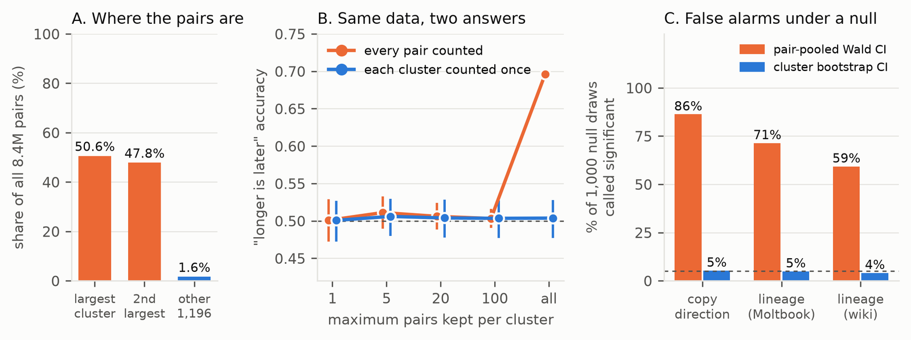

**Links:** [Report (PDF)](https://github.com/MAUK9086/swarm-lineage/blob/main/report/Paradox_Counting_Clusters_Not_Pairs_Report.pdf) · [Code](https://github.com/MAUK9086/swarm-lineage) · Apart Research Swarm Alignment Hackathon, November 2026 (submitted; sole author)

Question
------
When a swarm of AI agents misbehaves, investigators are often left with text that the agents copied and edited from one another, usually without reliable timestamps. Content-only tools that infer copy direction (which text came first) and lineage (who copied whom) are an obvious response. This project asks whether such tools work on agent-written text, and how they should be evaluated.

Setup
------
- **Corpora:** methods were developed on 300,000 posts from Moltbook (SimulaMet observatory archive), then frozen and run unchanged on the collusion.wiki export, whose revision history records true parent links.
- **Time isolation:** every method sees a table without timestamps. Only the evaluation module reads true time, when scoring.
- **Methods tested:** text length, shingle containment, insertion-versus-deletion edit direction, prefix/suffix extension, and minimum-spanning lineage trees over MinHash/LSH near-duplicate pairs.
- **Pre-registration:** each of the ~50 experiments has its question, hypothesis and go/no-go rule written in a lab log before it was run.

Findings
------
- **The standard cues reduce to length.** No cue beat &ldquo;the longer text is later&rdquo; by the pre-registered margin. That baseline is right for 0.66 of clusters across wiki pages, with no stable gain on Moltbook.
- **Lineage trees recover links, but so does a simple rule.** Against the wiki's recorded revision parents, the trees found 76% of true parent links, but &ldquo;parent = most similar shorter text&rdquo; did as well and oriented the links better.
- **The larger problem is evaluation.** Near-duplicates come in a few huge families: on Moltbook, two clusters hold 98% of 8.4 million pairs. Scoring pairs instead of clusters turns a chance-level result into 0.70 accuracy, and declares significance in 86% of null draws with no real order, against 5% when each cluster counts once.
- **A leak in our own pipeline.** One pre-registered success turned out to be a row-order leak. The frozen pipelines now shuffle rows before processing.

*Figure. (A) Two clusters hold almost all near-duplicate pairs. (B) The same &ldquo;longer is later&rdquo; rule scores at chance when each cluster counts once, but about 0.70 when every pair counts. (C) Under a null with no real order, pair-pooled confidence intervals call 59&ndash;86% of draws significant; a cluster bootstrap calls 4&ndash;5%.*

Recommendation
------
Content-only forensic tools for agent text should be scored per cluster, against a null that keeps clusters fixed, on shuffled inputs. The repository includes the pipeline, unit tests, the pre-registration log and an evaluation checklist that links each check to the experiment that applies it.
