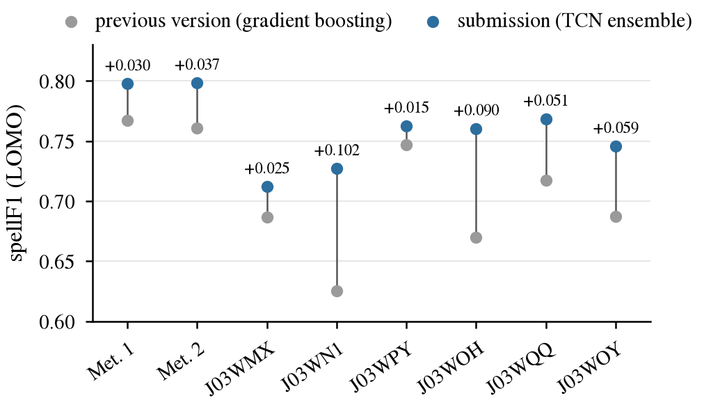

**Links:** [Code and technical report](https://github.com/MAUK9086/La-Espada-More-than-a-Hack-2027) · More than a Hack 2027, Phase 1: Ball Possession (submitted November 2026; solo entry as team La Espada)

Problem
------
The task is to label each of the 199,319 frames (25 fps) of FC Barcelona v Athletic Club as Barcelona in possession, Athletic in possession, or ball dead, using only the match's automatic tracking and event tags. Possession means *controlled* possession: a touch, a deflection or a lost duel does not change it. The ranking metric, spellF1, matches whole predicted and true possessions by temporal overlap (IoU 0.3–0.7). A short flicker of the wrong team therefore splits one possession into two, so a classifier that is right on most frames can still score poorly.

Method
------
- **Rule evidence:** hand-written rules on ball–player geometry (ball clean-up, speeds, nearest player per team) give per-frame scores for the three states and detect stop and kick events.
- **Learned evidence:** an ensemble of three dilated temporal convolutional networks (multi-stage TCN) reads 75 identity-free columns per frame, such as team shape, ball state and nearest-player kinematics. Each match is also presented with teams swapped and the pitch mirrored, so the model cannot favour either team or direction.
- **Training data:** the networks are trained only on eight external matches (six Sportec Open DFL matches and two Metrica sample games). These are degraded to reproduce the label-free statistics of the provided tracking. Nothing is fitted on the provided match or its ground truth, as the rules require.
- **Decoding:** a Viterbi pass per half combines rule scores with the networks' log-probabilities. State changes are cheap only near detected events, which removes flicker and places boundaries at plausible moments.
- **Reproducibility:** inference runs in NumPy float64 on committed weights and regenerates the submitted file byte for byte in under two minutes on a laptop CPU.

Results
------

| Evaluation | spellF1 |
|---|---|
| Leave-one-match-out, 8 external matches (mean) | 0.759 (previous gradient-boosting version: 0.708) |
| Held-out Sportec DFL match J03WR9 | 0.789 |
| Held-out Metrica sample game 3 | 0.814 |

*Figure. Leave-one-match-out spellF1 for each external match. The TCN ensemble (blue) improves on the earlier gradient-boosting model (grey) on all eight matches.*

Final standings are expected from the organisers at the end of November 2026.
