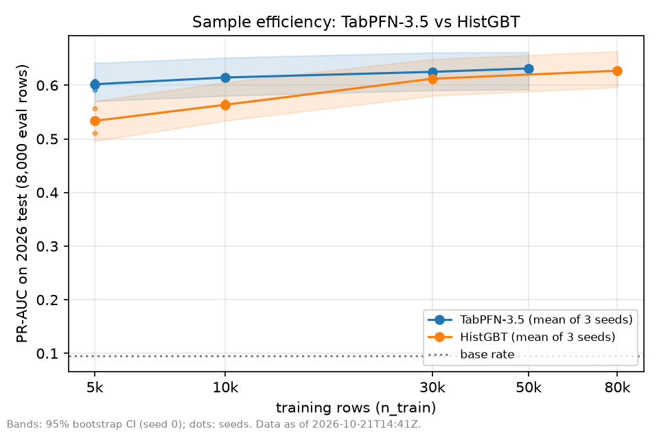

**Links:** [Code](https://github.com/MAUK9086/patch-sloth) · [Technical write-up](https://github.com/MAUK9086/patch-sloth/blob/master/patch-sloth/docs/WRITEUP.md) · [Open feed](https://github.com/MAUK9086/patch-sloth/releases/tag/feed-2026-10-23) · Built for the DEV Hacktoberfest 2026 Open-Source AI Challenge (not submitted); working prototype that runs locally

Problem
------
Since April 2026, the US National Vulnerability Database (NVD) marks many new CVEs as **Deferred** and does not analyse them. For those, the only severity score comes from the CNA, the organisation that reported the vulnerability, often the vendor itself. When NVD still reviewed CNA scores, it often disagreed: across 122,459 labelled CVEs it put 16.4% in a higher severity band. NVD is not ground truth either, as it tends to score the worst case, so Patch Sloth estimates whether an independent NVD-style reviewer would likely rate a CVE higher, and labels every output as an estimate for triage.

System
------
- **Data and labels:** 239,058 CVEs from 2021–2026, split by publication date (train before July 2025, validation 2025-H2, test 2026). A *bump* means NVD's severity band is higher than the CNA's. Features use only what is known on the day a CVE is published.
- **Second-opinion vector:** Qwen3-8B fine-tuned with LoRA (rank 32, 30,000 CVEs, $3.37) to predict NVD's CVSS vector.
- **Bump classifier:** TabPFN-3.5 stacked with the language model's features, with HistGBT as a CPU fallback. A gate uses the model's vector only when the classifier is confident, and keeps the CNA's otherwise.
- **Label-free decision bands:** "likely under-rated" is the top 10% of scores over Deferred CVEs, so no labels are used to set the cut-off. Plain probability thresholds failed under drift: NVD raised 23% of 2025-H2 CVEs but only 9% of 2026 ones.
- **Product:** a CLI and web page scan a `package-lock.json` or `requirements.txt` and sort its CVEs into patch now, this month, or later, using fixed priority rules (CISA KEV, EPSS, band). An LLM writes a short report behind a guardrail that checks every CVE ID and number against the input. All 58,457 CVEs NVD has not analysed are scored in an open feed.
- **Engineering:** 113 tests; every decision logged with its reason; reproducible from public data on a CPU.

Results
------
On 8,000 CVEs from 2026 (`results/final_table.md` in the repository):

| Measure | Result |
|---|---|
| Precision of "likely under-rated" | **0.75** (281 of 376), base rate 0.095 |
| PR-AUC for ranking bumped CVEs: TabPFN-3.5 + LLM stack | 0.621 (copying the CNA: 0.095) |
| Severity accuracy, fine-tuned Qwen3-8B vs copying the CNA, 2025-H2 | **0.869** vs 0.722 |
| Same, 2026 | 0.859 vs **0.880** |
| Gated system vs copying the CNA, 2026 | +2.0 points [+1.5, +2.5] |

- The fine-tuned model beats copying the CNA on 2025 data but not on 2026 data, when NVD changed far fewer CNA vectors. Only the gated system improves on the CNA in 2026, and only with the gate threshold tuned on the last three months of 2025. Tuned on all of 2025-H2, the same gate was 2.1 points worse.
- With all 80,098 training rows, HistGBT (0.627) and TabPFN-3.5 (0.631) are not significantly different. TabPFN's advantage is sample efficiency: on 5,000 rows it reaches 96% of fully trained HistGBT.

*Figure. PR-AUC on 8,000 CVEs from 2026 as training size grows. TabPFN-3.5 (blue) leads at 5,000–10,000 rows; the two converge with more data. Bands: 95% bootstrap intervals; dotted line: base rate.*
